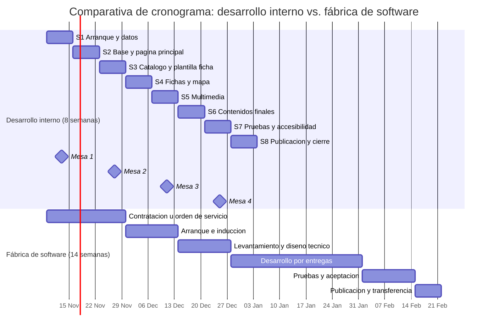

# Alcance y cronograma: landing Urbanismo táctico

Secretaría Distrital de Movilidad · Proyecto: micrositio de urbanismos tácticos y Barrios Vitales
Documento de planeación · Elaborado el 6 de noviembre de 2026

> **Nota sobre las cifras.** Las duraciones son estimaciones propias, calculadas a partir del análisis de los insumos (`ANALISIS-COMPLETO.md`) y del trabajo en los landings anteriores. No hay un plazo oficial ni condiciones contractuales de la fábrica de software en los insumos, así que lo referente a la fábrica es un supuesto típico y debe validarse con quien gestiona la contratación. Las semanas parten de un **inicio supuesto el lunes 9 de noviembre de 2026**; si cambia, solo se desplaza el calendario.

## 1. Alcance del desarrollo

### 1.1 Dentro del alcance

| # | Entregable | Descripción |
| :---- | :---- | :---- |
| 1 | Base de datos del proyecto | `intervenciones.json` con las 33 intervenciones, depurado desde el inventario (localidades y tipos unificados, códigos y direcciones). |
| 2 | Página principal | Los 8 bloques del wireframe aprobado: hero, cifras, qué es, buscador con filtros y esquema de localidades, tarjetas, tipos, videos, fichas técnicas y footer. |
| 3 | Catálogo con buscador y filtros | Búsqueda por nombre, dirección o localidad; filtros por tipo y localidad; alternador Lista/Mapa en móvil. |
| 4 | Mapa interactivo | Puntos de las intervenciones a partir de los archivos KMZ. |
| 5 | 33 fichas de intervención | Plantilla única, generada desde el JSON. Ficha completa para las 17 con registro de antes y después; ficha reducida para las 16 restantes. |
| 6 | Comparador antes/después | Control accesible por teclado, con galería (antes, durante, después). |
| 7 | Videos y descargas | Videos incrustados y descargas de ficha técnica, plano de áreas y KMZ. |
| 8 | Preguntas frecuentes, SEO y metadatos | Si el equipo aprueba incluir las preguntas frecuentes (no están en el wireframe). |
| 9 | Accesibilidad y adaptación a móvil | Revisión con `npm run lint:a11y` y pruebas manuales. |
| 10 | Publicación y entrega | Subida al servidor y documentación de mantenimiento. |

### 1.2 Fuera del alcance (salvo decisión contraria)

- Producción de fotos, videos y fichas técnicas en PDF (la hace el área técnica y la OAC).
- Redacción de los textos de problema y solución de las 14 fichas pendientes (los redacta el área técnica o la OAC; nosotros los maquetamos).
- Las intervenciones que están solo en el documento de contenidos (parklet de la calle 71, Suba-Tibabuyes, Parque Nacional) y las 3 "próximamente".
- Un sistema de administración para que el área técnica edite sin tocar archivos. Los cambios pasan por el equipo de desarrollo.
- Alojamiento, dominio y certificados (los gestiona TI).

### 1.3 Supuestos

1. El wireframe aprobado es la referencia visual vinculante.
2. El desarrollo es un sitio estático, como los demás landings de Movilidad.
3. El área técnica entrega el material multimedia y los textos en las fechas límite de la sección 3.
4. TI habilita el subdominio `urbanismostacticos.movilidadbogota.gov.co`.
5. Las decisiones pendientes del análisis se cierran en la primera mesa técnica.

## 2. Dependencias y mesas técnicas

| Mesa | Dependencias | Para qué |
| :---- | :---- | :---- |
| Área técnica (urbanismo táctico y Barrios Vitales) | Dueña de los datos | Validar inventario, tipos, direcciones, textos de las fichas; entregar fotos, KMZ, planos y fichas técnicas. |
| OAC (comunicaciones) | Dueña de la identidad y los videos | Decidir título, logotipo, tono, videos y preguntas frecuentes; aprobar el diseño. |
| TI / infraestructura web | Publicación | Subdominio, ruta de activos, seguridad, certificados, tiempos de publicación. |
| Accesibilidad y calidad (si aplica) | Validación | Revisar contraste, teclado y lectores de pantalla. |
| Jurídica o protección de datos (por verificar) | Cumplimiento | Autorización de uso de imagen de personas en fotos y testimonios; política de tratamiento de datos del footer. |

## 3. Etapas y cronograma: desarrollo interno

Duración estimada: **8 semanas**, con 5 entregas y 4 mesas de validación. Una ruta acelerada de 6 semanas es posible solo si el material completo llega al final de la semana 2.

| Semana | Etapa | Actividades | Entrega / hito |
| :---- | :---- | :---- | :---- |
| **1** | **Etapa 1: Arranque y datos** | Cerrar las decisiones pendientes; depurar el inventario y generar `intervenciones.json`; estructurar el proyecto y definir tokens de diseño; solicitar el material. | **E1:** alcance cerrado, JSON validado y lista de material con responsables. **Mesa 1** (área técnica + OAC): decisiones, alcance, calendario. |
| **2** | **Etapa 2: Base y página principal** | Estilos base y componentes GOV.CO; página principal con datos reales y marcadores de posición; esquema de localidades calculado desde el JSON. | Avance interno. **Fecha límite:** logotipo, archivo de diseño, KMZ y direcciones. |
| **3** | **Etapa 3: Catálogo y plantilla de ficha** | Buscador y filtros; plantilla de ficha; script que genera las fichas; vista móvil. | **E2:** prototipo navegable (principal + ficha de ejemplo) con datos reales. **Mesa 2** (OAC + área técnica): validar diseño, tono y fichas. |
| **4** | **Etapa 4: Fichas y mapa** | Generar las 33 fichas; mapa con coordenadas de los KMZ; "Cerca de aquí"; fichas reducidas para las 16 sin fotos. | **Fecha límite:** textos de problema y solución de las 17 fichas completas. |
| **5** | **Etapa 5: Multimedia** | Optimizar e integrar fotos; comparador antes/después; galería; videos; descargas. | **E3:** sitio completo con material real disponible. **Mesa 3** (área técnica + TI): validar datos y planear la publicación. |
| **6** | **Etapa 6: Contenidos finales** | Textos definitivos; preguntas frecuentes; SEO y metadatos; ajustes del tono. | Contenidos cargados al 100 %. |
| **7** | **Etapa 7: Pruebas y accesibilidad** | Accesibilidad, rendimiento, navegadores y móviles; corrección de hallazgos. | **E4:** versión candidata. **Mesa 4** (todas las dependencias): pruebas de aceptación y aprobación. |
| **8** | **Etapa 8: Publicación y cierre** | Ajustes finales; publicación en el subdominio; verificación posterior; documentación de mantenimiento. | **E5:** sitio publicado y documentación. **Mesa 5:** entrega y plan de mantenimiento. |

### 3.1 Fechas límite críticas del área técnica

| Fecha límite | Qué debe llegar | Si se retrasa |
| :---- | :---- | :---- |
| Fin de la semana 1 | Decisiones del análisis (título, logotipo, alcance 33/17, vista de fichas técnicas) | Se retrasa toda la etapa 2. |
| Fin de la semana 2 | Logotipo y archivo de diseño; KMZ y direcciones de las 33 | No hay mapa ni colores finales. |
| Fin de la semana 3 | Fotos de antes y después de las 17 | La etapa 5 se retrasa. |
| Fin de la semana 4 | Textos de problema y solución de las 17 | Las fichas salen con texto provisional. |
| Fin de la semana 5 | Videos y fichas técnicas PDF | Se publica sin esa sección y se completa después. |

### 3.2 Ruta mínima (si el tiempo aprieta)

Publicar en la semana 6 con: página principal completa, 33 fichas (17 completas y 16 reducidas), mapa y preguntas frecuentes. Videos, fichas técnicas y planos se agregan en una segunda entrega. Reduce el riesgo, pero deja secciones del wireframe vacías al inicio.

## 4. Desarrollo con fábrica de software

### 4.1 Cómo cambiaría el cronograma (estimación)

Una fábrica añade pasos que el equipo interno no necesita. Con un rango típico, el mismo alcance tomaría de **12 a 16 semanas** (14 en la estimación central del diagrama).

| Fase | Duración estimada | Qué ocurre |
| :---- | :---- | :---- |
| Gestión de contratación o de la orden de servicio | 2 a 4 semanas | Estudios previos, anexos técnicos, aprobación, firma. Depende de si ya existe un contrato marco. |
| Arranque e inducción | 1 a 2 semanas | La fábrica debe conocer el repositorio, las reglas GOV.CO, los landings anteriores, el wireframe y los accesos. |
| Levantamiento y diseño técnico | 1 a 2 semanas | Documentos de requisitos y arquitectura, que la entidad debe aprobar. |
| Desarrollo por entregas (sprints) | 5 a 6 semanas | Entregas cada 1 o 2 semanas con revisión formal. |
| Pruebas y aceptación | 2 semanas | Pruebas de la fábrica y de la entidad, con ciclos de corrección. |
| Publicación y transferencia | 1 semana | La entidad publica; la fábrica entrega código y documentación. |

### 4.2 Impedimentos y limitaciones

1. **Tiempo de contratación.** Es el mayor factor. Si la urgencia no permite hacer el proceso, la fábrica no puede empezar. No se puede acortar con trabajo interno.
2. **Curva de conocimiento.** El proyecto depende de reglas propias (componentes GOV.CO, ruta de activos del portal, estructura de los landings, terminología). Todo eso tendría que explicarse y documentarse.
3. **Cambios de alcance.** Este proyecto tiene decisiones abiertas (título, 17 o 33 intervenciones, logotipo, vistas). En una fábrica, cada cambio suele pasar por una solicitud de cambio, con costo y tiempo adicionales.
4. **Ciclos de revisión.** Las mesas técnicas funcionarían igual, pero la corrección de lo observado se mide en días hábiles de la fábrica, no en horas.
5. **Material multimedia.** La fábrica no resuelve la ausencia de fotos, videos y KMZ: sigue siendo la ruta crítica y depende del área técnica.
6. **Accesos y seguridad.** La fábrica necesita acceso a la ruta de activos y al servidor o a un intermediario de TI. Los trámites de acceso añaden días.
7. **Calidad y control.** Hay que revisar cada entrega con criterios de accesibilidad y las reglas del proyecto. Si no hay revisor interno disponible, el riesgo de retrabajo aumenta.
8. **Mantenimiento.** Cada ajuste posterior (nuevas intervenciones, videos) dependería de la fábrica o de una transferencia de conocimiento.
9. **Datos y protección de datos.** Compartir fotos de personas y el inventario con un tercero puede requerir cláusulas de confidencialidad y tratamiento de datos.

### 4.3 Qué sí aporta una fábrica

- Capacidad adicional de desarrollo, diseño y pruebas en paralelo.
- Menor dependencia de una persona del equipo interno.
- Procesos de calidad y documentación formales.
- Buena opción para una segunda fase (por ejemplo, un sistema de administración o los 17 capítulos de video).

## 5. Comparativa: desarrollo interno vs. fábrica de software

| Criterio | Desarrollo interno (nosotros) | Fábrica de software |
| :---- | :---- | :---- |
| Duración estimada | **8 semanas** (ruta mínima: 6) | **12 a 16 semanas** (14 en la estimación central) |
| Inicio | Inmediato | Después de contratación e inducción (3 a 6 semanas) |
| Conocimiento del proyecto | Ya está en el equipo y en el repositorio | Hay que transferirlo |
| Cambios de alcance | Se absorben en el día a día | Solicitud de cambio formal |
| Ritmo de las mesas técnicas | Revisión y corrección en pocos días | Revisión por entregas; correcciones en el siguiente ciclo |
| Control de calidad | Directo | Requiere revisión interna de cada entrega |
| Capacidad | Limitada (poco equipo, otras tareas) | Mayor |
| Riesgo principal | Sobrecarga del equipo y dependencia de pocas personas | Plazo de contratación y curva de aprendizaje |
| Mantenimiento posterior | En el equipo | Depende del contrato |
| Costo | Tiempo del equipo interno | Costo contractual (no estimado aquí) |
| Idoneidad para la urgencia | **Alta** | Baja |

### 5.1 Diagrama comparativo de tiempos

El diagrama usa el inicio supuesto del 9 de noviembre de 2026 y la estimación central de 14 semanas para la fábrica.

Resumen visual: con desarrollo interno la publicación se alcanza hacia la semana 8. Con fábrica, las primeras 5 semanas se van en contratación e inducción, y la publicación llega hacia la semana 14, es decir, unas 6 semanas después.

### 5.2 Diagrama de flujo de las entregas y mesas (desarrollo interno)

```mermaid
flowchart LR
    A[Semana 1<br/>Arranque y datos] -->|E1| M1{{Mesa 1<br/>Área técnica + OAC}}
    M1 --> B[Semanas 2 y 3<br/>Base, catálogo y plantilla]
    B -->|E2| M2{{Mesa 2<br/>OAC + Área técnica}}
    M2 --> C[Semanas 4 y 5<br/>Fichas, mapa y multimedia]
    C -->|E3| M3{{Mesa 3<br/>Área técnica + TI}}
    M3 --> D[Semanas 6 y 7<br/>Contenidos y pruebas]
    D -->|E4| M4{{Mesa 4<br/>Aceptación}}
    M4 --> E[Semana 8<br/>Publicación]
    E -->|E5| M5{{Mesa 5<br/>Entrega y mantenimiento}}
```

## 6. Riesgos y mitigación (desarrollo interno)

| Riesgo | Impacto | Mitigación |
| :---- | :---- | :---- |
| El material multimedia llega tarde | Alto | Fechas límite por mesa (sección 3.1); ruta mínima publicable; marcadores de posición hasta que llegue. |
| Decisiones abiertas sin cerrar | Alto | Cerrarlas en la Mesa 1; documentar quién decide. |
| Sobrecarga del equipo | Alto | Priorizar este proyecto; congelar el alcance tras la mesa 2. |
| Cambios de alcance tardíos | Medio | Control de cambios simple: todo cambio posterior a la mesa 2 se evalúa antes de aceptarlo. |
| Calendario de fin de año (festivos, vacaciones) | Medio | Revisar el calendario antes de fijar las mesas; evitar publicar entre Navidad y Año Nuevo. |
| Fallas de accesibilidad | Medio | Revisión desde la etapa 2, no al final. |
| Publicación en el subdominio demorada | Medio | Pedir a TI en la semana 1 el subdominio y la ruta de activos. |
| Uso de imagen de personas sin autorización | Medio | Verificar con jurídica antes de publicar fotos y testimonios. |

## 7. Recomendación

1. **Hacer el desarrollo interno**, dado que la urgencia no permite el plazo de contratación y que el conocimiento del proyecto ya está en el equipo.
2. **Cerrar en la primera semana** las decisiones del análisis y pedir el material con fechas límite.
3. **Apuntar a la ruta mínima** en la semana 6 si el calendario de fin de año lo exige, y completar videos y descargas en una segunda entrega.
4. **Dejar la fábrica para una segunda fase**: un sistema de administración para el área técnica o la producción de los capítulos de video. Así se aprovecha su capacidad sin afectar el plazo inicial.

## 8. Qué necesito de ti para ajustar este documento

- Fecha límite real de publicación, si existe.
- Cuántas personas del equipo trabajarían en esto y con qué dedicación. Las 8 semanas asumen un equipo pequeño con dedicación principal.
- Si ya existe un contrato marco con la fábrica o hay que contratar desde cero. Cambia el cálculo de las 3 primeras semanas.
- Si el calendario de mesas ya está definido con las dependencias.
